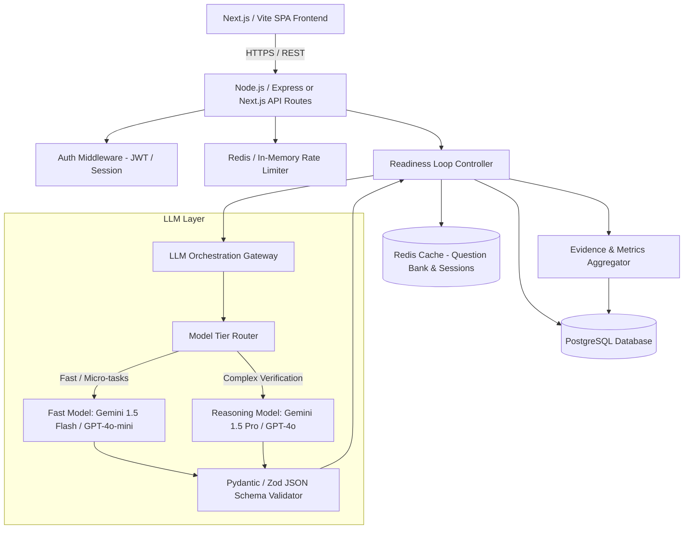
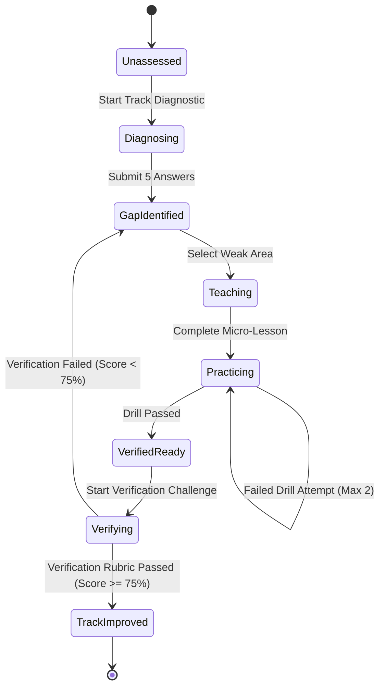

# System Architecture Document

## 1. Architectural Philosophy
The architecture is designed around three non-negotiable principles:
1. **Low Operational Complexity**: Prioritize battle-tested, lightweight primitives over premature microservices.
2. **Deterministic Evaluation Structure**: Never allow unstructured, unpredictable free-text LLM responses in evaluation pipelines. All evaluations must pass strict JSON schema validation.
3. **Cost & Latency Tiering**: Route simple classification/drill evaluation to cost-effective models, reserving higher-tier reasoning models strictly for multi-turn verification scoring.

---

## 2. High-Level System Architecture



---

## 3. Technology Stack Selection & Rationale

| Layer | Chosen Technology | Rationale & Trade-offs |
|---|---|---|
| **Frontend** | React / Next.js (TypeScript) + Tailwind CSS + Radix UI / shadcn | Modern, highly responsive UI, zero-hassle SSR/SSG for static remediation content, strong typing for complex rubric visualization. |
| **Backend API** | Node.js (TypeScript) with Express or Next.js App Router API | Unified TypeScript codebase sharing types (Zod schemas) between client and server; fast I/O for streaming LLM responses. |
| **Database** | PostgreSQL (via Supabase or Neon) | Relational integrity for user attempts, question banks, rubrics, and versioned audit logs. Support for JSONB for semi-structured rubric criteria. |
| **ORM / Migration** | Prisma or Drizzle ORM | Type-safe queries, migration control, zero-drift schema definition. |
| **Caching & Rate Limiting** | Redis (Upstash / Redis Cloud) | Token bucket rate limiting per user (prevents API abuse/DDoS), fast session state caching, and caching static question metadata. |
| **LLM Provider Gateway** | Unified Provider SDK (Vercel AI SDK or direct OpenAI/Google GenAI SDK) | Standardized streaming, fallback model routing, and built-in structured schema outputs. |
| **Validation Layer** | Zod (TypeScript) | Strict runtime schema enforcement for all LLM JSON outputs. Prevents malformed evaluation payloads from reaching the DB. |

---

## 4. The Readiness Loop State Machine



### State Definitions:
1. `DIAGNOSING`: Candidate is answering the initial domain probe. System captures baseline capability.
2. `GAP_IDENTIFIED`: Analysis algorithm highlights specific rubric dimensions with score < 65%.
3. `TEACHING`: Candidate accesses target micro-lesson. System tracks completion timestamp.
4. `PRACTICING`: Candidate solves targeted scenario drill with instant unit/rubric check.
5. `VERIFYING`: Candidate enters multi-turn scenario interview with constraint follow-ups.
6. `TRACK_IMPROVED`: Score updated in `CandidateCompetency` table; evidence snippet appended to audit log.

---

## 5. LLM-as-a-Judge Orchestration Pattern

To guarantee evaluation consistency and avoid score drift:
1. **Few-Shot Calibration**: Every judge prompt includes 2 anchored examples:
   * A "Poor" answer (superficial, buzzword-heavy, missing trade-offs) with expected score ~30-40.
   * A "Strong" answer (clear architectural boundaries, specific trade-offs, edge-case mitigation) with expected score ~85-95.
2. **Two-Stage Prompting**:
   * *Stage 1 (Critique & Evidence Extraction)*: The model must first extract literal quotes from the candidate's answer and state specific pros/cons before computing numerical scores.
   * *Stage 2 (Rubric Scoring)*: Scores are assigned strictly against predefined rubric keys.
3. **Structured Output Enforcement**:
   ```typescript
   // Evaluation Output Schema via Zod
   const EvaluationResponseSchema = z.object({
     overallScore: z.number().min(0).max(100),
     rubricScores: z.object({
       technicalSoundness: z.number().min(0).max(100),
       tradeOffAnalysis: z.number().min(0).max(100),
       edgeCaseHandling: z.number().min(0).max(100),
       communicationClarity: z.number().min(0).max(100),
     }),
     evidenceQuotes: z.array(z.string()),
     identifiedMisconceptions: z.array(z.string()),
     actionableAdvice: z.string().max(400),
   });
   ```

---

## 6. Latency & Cost Optimization Strategy

1. **Model Tiering**:
   * *Diagnostic Scoring & Drill Check*: Run on fast, cheap models (`gemini-1.5-flash` or `gpt-4o-mini`). Latency: ~1-1.5s. Cost: negligible (< $0.001 per run).
   * *Comprehensive Verification Challenge*: Run on high-fidelity reasoning models (`gemini-1.5-pro` or `gpt-4o`). Latency: ~2.5-4s. Cost: ~ $0.01 per run.
2. **Prompt Optimization**:
   * System prompts are pre-compiled and kept concise.
   * Static rubrics and question templates are cached in Redis to minimize database lookups.
3. **Asynchronous Verification Scoring**:
   * Client renders optimistic UI states while streaming the feedback critique, preventing users from waiting at blank loading screens.
4. **Token Caps**:
   * Strict `max_tokens` limits (e.g., 600 tokens for evaluation output) to prevent runaway generations.

---

## 7. Reliability, Fallbacks & Error Handling

* **LLM JSON Schema Retry Protocol**:
  If the LLM returns invalid JSON or fails the Zod schema validation:
  1. Trigger 1 automatic retry with temperature set to 0.0 and error feedback appended.
  2. If retry fails, trigger fallback parser (regex extraction of JSON substring).
  3. If all fail, return graceful fallback HTTP 502 with friendly UI state: *"Evaluation taking longer than expected. Retrying automatically..."*
* **Idempotency**:
  All submission endpoints accept an `idempotencyKey` (UUID) to prevent double-charging or duplicate attempt creation on network retry.
