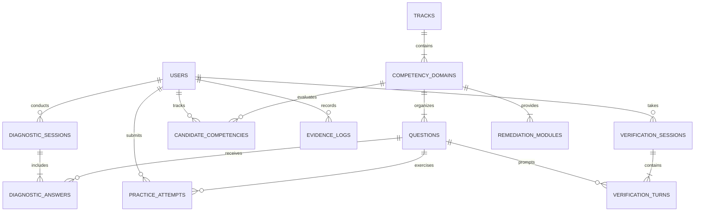

# Data Model & Schema Specification

## 1. Entity-Relationship Overview



---

## 2. PostgreSQL Relational Schema (DDL)

```sql
-- 1. Enum Types
CREATE TYPE user_role AS ENUM ('student', 'admin');
CREATE TYPE track_slug AS ENUM ('ai_engineer', 'genai_engineer');
CREATE TYPE question_type AS ENUM ('diagnostic', 'drill', 'verification');
CREATE TYPE session_status AS ENUM ('in_progress', 'completed', 'abandoned');
CREATE TYPE verification_grade AS ENUM ('exceeds_bar', 'meets_bar', 'below_bar', 'unsatisfactory');

-- 2. Users Table
CREATE TABLE users (
    id UUID PRIMARY KEY DEFAULT gen_random_uuid(),
    email VARCHAR(255) UNIQUE NOT NULL,
    full_name VARCHAR(150) NOT NULL,
    target_track track_slug NOT NULL DEFAULT 'genai_engineer',
    graduation_year INT,
    institution_name VARCHAR(255),
    created_at TIMESTAMPTZ NOT NULL DEFAULT NOW(),
    updated_at TIMESTAMPTZ NOT NULL DEFAULT NOW()
);

-- 3. Tracks & Domains
CREATE TABLE tracks (
    id UUID PRIMARY KEY DEFAULT gen_random_uuid(),
    slug track_slug UNIQUE NOT NULL,
    title VARCHAR(100) NOT NULL,
    description TEXT NOT NULL,
    created_at TIMESTAMPTZ NOT NULL DEFAULT NOW()
);

CREATE TABLE competency_domains (
    id UUID PRIMARY KEY DEFAULT gen_random_uuid(),
    track_id UUID NOT NULL REFERENCES tracks(id) ON DELETE CASCADE,
    slug VARCHAR(80) NOT NULL,
    title VARCHAR(150) NOT NULL,
    description TEXT,
    display_order INT NOT NULL DEFAULT 0,
    created_at TIMESTAMPTZ NOT NULL DEFAULT NOW(),
    CONSTRAINT uq_track_domain_slug UNIQUE (track_id, slug)
);

-- 4. Questions & Rubrics Bank
CREATE TABLE questions (
    id UUID PRIMARY KEY DEFAULT gen_random_uuid(),
    domain_id UUID NOT NULL REFERENCES competency_domains(id) ON DELETE RESTRICT,
    q_type question_type NOT NULL,
    title VARCHAR(255) NOT NULL,
    prompt_text TEXT NOT NULL,
    code_snippet TEXT,
    difficulty_level VARCHAR(20) NOT NULL DEFAULT 'intermediate', -- 'foundational', 'intermediate', 'advanced'
    rubric_guidelines JSONB NOT NULL, 
    -- Format: {
    --   "criteria": ["technical_soundness", "tradeoffs", "edge_cases"],
    --   "benchmark_positive": "...",
    --   "benchmark_negative": "..."
    -- }
    is_active BOOLEAN NOT NULL DEFAULT TRUE,
    created_at TIMESTAMPTZ NOT NULL DEFAULT NOW()
);

-- 5. Diagnostic Sessions & Answers
CREATE TABLE diagnostic_sessions (
    id UUID PRIMARY KEY DEFAULT gen_random_uuid(),
    user_id UUID NOT NULL REFERENCES users(id) ON DELETE CASCADE,
    track_id UUID NOT NULL REFERENCES tracks(id) ON DELETE RESTRICT,
    status session_status NOT NULL DEFAULT 'in_progress',
    overall_score NUMERIC(5,2), -- 0.00 to 100.00
    gap_summary JSONB, -- list of domain-specific weaknesses & quotes
    started_at TIMESTAMPTZ NOT NULL DEFAULT NOW(),
    completed_at TIMESTAMPTZ
);

CREATE TABLE diagnostic_answers (
    id UUID PRIMARY KEY DEFAULT gen_random_uuid(),
    session_id UUID NOT NULL REFERENCES diagnostic_sessions(id) ON DELETE CASCADE,
    question_id UUID NOT NULL REFERENCES questions(id) ON DELETE RESTRICT,
    candidate_answer TEXT NOT NULL,
    score NUMERIC(5,2),
    feedback JSONB, -- { "pros": [], "cons": [], "misconceptions": [] }
    evaluated_at TIMESTAMPTZ
);

-- 6. Remediation & Micro-Lessons
CREATE TABLE remediation_modules (
    id UUID PRIMARY KEY DEFAULT gen_random_uuid(),
    domain_id UUID NOT NULL REFERENCES competency_domains(id) ON DELETE CASCADE,
    title VARCHAR(200) NOT NULL,
    content_markdown TEXT NOT NULL,
    anti_patterns TEXT,
    production_patterns TEXT,
    estimated_read_minutes INT NOT NULL DEFAULT 4,
    created_at TIMESTAMPTZ NOT NULL DEFAULT NOW()
);

-- 7. Practice Attempts (Drills)
CREATE TABLE practice_attempts (
    id UUID PRIMARY KEY DEFAULT gen_random_uuid(),
    user_id UUID NOT NULL REFERENCES users(id) ON DELETE CASCADE,
    question_id UUID NOT NULL REFERENCES questions(id) ON DELETE RESTRICT,
    attempt_number INT NOT NULL DEFAULT 1,
    candidate_response TEXT NOT NULL,
    is_passed BOOLEAN NOT NULL DEFAULT FALSE,
    evaluation_breakdown JSONB,
    created_at TIMESTAMPTZ NOT NULL DEFAULT NOW()
);

-- 8. Verification Sessions & Turns (Mock Rounds)
CREATE TABLE verification_sessions (
    id UUID PRIMARY KEY DEFAULT gen_random_uuid(),
    user_id UUID NOT NULL REFERENCES users(id) ON DELETE CASCADE,
    domain_id UUID NOT NULL REFERENCES competency_domains(id) ON DELETE RESTRICT,
    status session_status NOT NULL DEFAULT 'in_progress',
    final_grade verification_grade,
    composite_score NUMERIC(5,2), -- 0.00 to 100.00
    started_at TIMESTAMPTZ NOT NULL DEFAULT NOW(),
    completed_at TIMESTAMPTZ
);

CREATE TABLE verification_turns (
    id UUID PRIMARY KEY DEFAULT gen_random_uuid(),
    session_id UUID NOT NULL REFERENCES verification_sessions(id) ON DELETE CASCADE,
    turn_index INT NOT NULL, -- 1 = Initial Scenario, 2 = Follow-up Stress Test
    interviewer_prompt TEXT NOT NULL,
    candidate_response TEXT NOT NULL,
    turn_score NUMERIC(5,2),
    rubric_scores JSONB, -- {"technicalSoundness": 80, "tradeOffAnalysis": 65, "edgeCaseHandling": 70}
    evidence_quote TEXT,
    critique TEXT,
    created_at TIMESTAMPTZ NOT NULL DEFAULT NOW()
);

-- 9. Candidate Competency & Readiness Index
CREATE TABLE candidate_competencies (
    id UUID PRIMARY KEY DEFAULT gen_random_uuid(),
    user_id UUID NOT NULL REFERENCES users(id) ON DELETE CASCADE,
    domain_id UUID NOT NULL REFERENCES competency_domains(id) ON DELETE RESTRICT,
    baseline_score NUMERIC(5,2) DEFAULT 0.00,
    current_verified_score NUMERIC(5,2) DEFAULT 0.00,
    attempts_count INT NOT NULL DEFAULT 0,
    last_verified_at TIMESTAMPTZ,
    updated_at TIMESTAMPTZ NOT NULL DEFAULT NOW(),
    CONSTRAINT uq_user_domain UNIQUE (user_id, domain_id)
);

-- 10. Verifiable Evidence Logs
CREATE TABLE evidence_logs (
    id UUID PRIMARY KEY DEFAULT gen_random_uuid(),
    user_id UUID NOT NULL REFERENCES users(id) ON DELETE CASCADE,
    domain_id UUID NOT NULL REFERENCES competency_domains(id) ON DELETE RESTRICT,
    session_id UUID REFERENCES verification_sessions(id) ON DELETE SET NULL,
    criterion VARCHAR(100) NOT NULL, -- e.g. 'Chunking Strategy Trade-offs'
    demonstrated_behavior TEXT NOT NULL,
    candidate_quote TEXT NOT NULL,
    recorded_at TIMESTAMPTZ NOT NULL DEFAULT NOW()
);

-- Indexes for performance
CREATE INDEX idx_questions_domain_type ON questions(domain_id, q_type);
CREATE INDEX idx_diag_sess_user ON diagnostic_sessions(user_id);
CREATE INDEX idx_verif_sess_user ON verification_sessions(user_id);
CREATE INDEX idx_cand_comp_user ON candidate_competencies(user_id);
CREATE INDEX idx_evidence_user ON evidence_logs(user_id);
```

---

## 3. Seed Domains for Initial Tracks

### Track 1: GenAI Engineer (`genai_engineer`)
1. **Domain 1: Vector Databases, Indexing & Embeddings** (Hierarchical chunking, cosine vs dot product, HNSW parameters, rerankers).
2. **Domain 2: RAG Architectures & Retrieval Trade-offs** (Hybrid search, parent document retriever, context window overflow handling, hallucination reduction).
3. **Domain 3: Prompt Engineering & Evaluation Systems** (Few-shot prompting, chain-of-thought, LLM-as-a-judge calibration, Ragas metrics).
4. **Domain 4: Model Adaptation & Fine-Tuning Principles** (When to fine-tune vs RAG, LoRA, QLoRA, rank r, alpha, catastrophic forgetting).
5. **Domain 5: Production Latency, Guardrails & Cost** (Streaming, token budgeting, NeMo Guardrails/Llama Guard, semantic caching).

### Track 2: AI Engineer Core (`ai_engineer`)
1. **Domain 1: PyTorch & Deep Learning Fundamentals** (Autograd, tensors, loss functions, custom datasets/dataloaders).
2. **Domain 2: Evaluation Metrics & Validation Schemes** (ROC-AUC, Precision-Recall tradeoff, class imbalance, cross-validation leaks).
3. **Domain 3: Model Optimization & Quantization** (Post-training quantization INT8/INT4, pruning, ONNX runtime conversion).
4. **Domain 4: Data Pipelines & Feature Stores** (Drift detection, feature leakage, batch vs stream inference).
