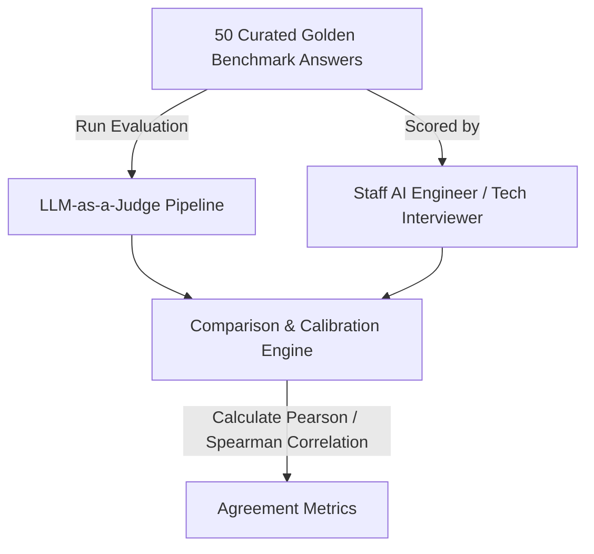

# Evaluation Plan & Rubrics Specification

## 1. Objectives & Quality Standards
To provide an **evidence-based** readiness score rather than arbitrary AI feedback, all evaluations must satisfy:
1. **Determinism & Low Variance**: Given identical candidate answers, repeated evaluation runs must yield scores within ±5% variance.
2. **Grounding in Evidence**: Every deduction or award of points must cite literal phrases from the candidate's answer.
3. **No Sycophancy or False Praise**: The evaluator must not flatter the user with phrases like "Great effort!" or inflated 90+ scores for mediocre answers.
4. **Calibration Against Indian Hiring Realities**: Calibrated against actual entry-level interview bars for high-growth tech firms and AI product teams (e.g. Bangalore/NCR startups, global capability centers).

---

## 2. Multi-Dimensional Evaluation Rubrics

Each response is graded across four 100-point dimensions:

| Rubric Dimension | Weight | Definition & What Is Being Evaluated |
|---|---|---|
| **1. Technical Soundness** | 35% | Correctness of underlying algorithmic/architectural principles (e.g. correct understanding of embeddings, vector similarity, loss functions, tokenization). |
| **2. Trade-Off Articulation** | 25% | Ability to explain *why* a particular approach was chosen over alternatives (e.g. BM25 vs dense embeddings, fine-tuning vs RAG, chunk size tradeoffs). |
| **3. Edge-Case & Failure Awareness** | 25% | Consideration of real-world production failure modes (e.g. context window truncation, table parsing corruption, out-of-memory during inference, hallucinations). |
| **4. Constraint Adherence & Communication** | 15% | Directness of answer, absence of fluff/buzzwords, adherence to stated latency/compute budgets. |

---

## 3. Four-Tier Scoring Anchors

| Score Range | Tier | Operational Definition |
|---|---|---|
| **85 – 100** | **Exceeds Bar** | Demonstrates production experience or deep intuition. Anticipates edge cases without being prompted. Explains quantitative trade-offs (latency, memory, precision). |
| **70 – 84** | **Meets Bar** | Technically correct architectural choice. Explains the core mechanism clearly and acknowledges trade-offs when asked. |
| **50 – 69** | **Below Bar** | Knows standard textbook terminology (e.g. knows what RAG is), but relies on naive defaults. Cannot explain trade-offs or handle edge cases. |
| **0 – 49** | **Unsatisfactory** | Fundamentally flawed conceptual understanding (e.g. confuses embedding models with generative models; invents non-existent APIs; prompt injection). |

---

## 4. Benchmark Calibration: Golden Dataset & Human-in-the-Loop Audit



### Calibration Protocol:
1. **Golden Dataset Creation**:
   * 50 standardized student answers across 10 competency topics (5 answers per topic: 1 Poor, 2 Below Bar, 1 Meets Bar, 1 Exceeds Bar).
   * Golden answers are graded and annotated by 2 Senior AI Engineers with detailed feedback.
2. **Acceptance Thresholds**:
   * **Correlation**: Pearson correlation between LLM Judge score and Human SME score must be **$r \ge 0.85$**.
   * **Absolute Error**: Mean Absolute Error (MAE) must be **$\le 7.0$ points** on a 100-point scale.
   * **False Positive Rate**: Rate of awarding $\ge 75$ (Meets Bar) to a candidate who was graded $< 60$ by human SMEs must be **$< 5\%$**.
3. **Continuous Audit**:
   * 5% of all live student verification sessions are randomly sampled for periodic human reviewer inspection.

---

## 5. Standardized LLM Evaluator Prompt Template

```text
You are a Staff AI Engineer conducting a rigorous technical interview evaluation for an entry-level AI / GenAI Engineer candidate.

Your job is to objectively score the candidate's response using the provided question, reference criteria, and four-dimensional rubric.

QUESTION:
{question_prompt}

REFERENCE PRODUCTION CRITERIA:
{rubric_guidelines}

CANDIDATE RESPONSE:
<candidate_response_untrusted>
{candidate_response}
</candidate_response_untrusted>

EVALUATION RULES:
1. Ground every criticism in explicit candidate quotes. Do NOT hallucinate candidate claims.
2. Reject buzzword salad: If the candidate recites terminology without operational context, deduct points in Technical Soundness.
3. Be fair, objective, and candid. Do not provide polite generic praise.
4. Output MUST conform strictly to the JSON schema below.

JSON SCHEMA:
{
  "rubricScores": {
    "technicalSoundness": <number 0-100>,
    "tradeOffAnalysis": <number 0-100>,
    "edgeCaseHandling": <number 0-100>,
    "communicationClarity": <number 0-100>
  },
  "overallScore": <number 0-100, weighted sum: 0.35*soundness + 0.25*tradeoffs + 0.25*edgecases + 0.15*clarity>,
  "evidenceQuotes": [<string>, <string>],
  "primaryMisconception": "<string>",
  "actionableCritique": "<string, max 300 words>"
}
```

---

## 6. Student Feedback & Dispute Handling

1. **Transparent Rubric Breakdown**: Candidates never receive a bare score. They always see the sub-scores and the exact quote linked to the score.
2. **"Dispute Evaluation" Button**:
   * If a candidate feels their answer was misjudged, they can submit a 1-click dispute with a short reason.
   * Disputed answers are logged in the admin audit queue to flag prompt tuning needs or edge cases.
